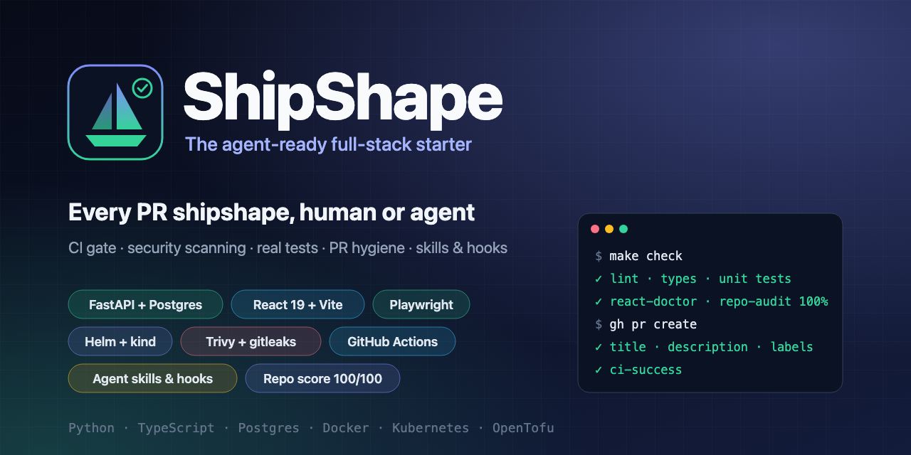
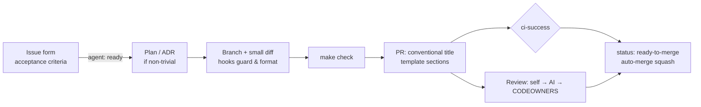

<p align="center">
  
</p>

<p align="center">
  <a href="https://github.com/edwinjosechittilappilly/shipshape-stack/actions/workflows/ci.yml"></a>
  <a href="https://github.com/edwinjosechittilappilly/shipshape-stack/actions/workflows/security.yml"></a>
  <a href="LICENSE"></a>
  <a href=".agents/skills/repo-audit/SKILL.md"></a>
  <a href="https://www.conventionalcommits.org"></a>
  <a href="https://pre-commit.com"></a>
</p>

<p align="center">
  
  
  
  
  
  
  
  
  
  
  
  
  
</p>

<p align="center">
  
  
  
  
</p>

# ShipShape: the agent-ready full-stack starter template

**ShipShape** is an open-source starter template for full-stack, cloud-native applications. It comes with CI/CD,
security scanning, tests, PR hygiene and AI coding agent guardrails already set up, so humans and coding agents
work to the same standard from the first commit. It includes a FastAPI + Postgres backend, a React + TypeScript
frontend, Docker, a Helm chart for Kubernetes, and GitHub Actions. Claude Code, Codex and Cursor get the same
skills and hooks.

> Most repositories have no single command that proves a change is safe, no written definition of done, and no
> rules a coding agent can follow. ShipShape makes the safe way the easy way: one command to verify, one required
> check to merge, written skills for agents, and a score that tells you how close any repo is to that bar.

**[Use this template →](https://github.com/edwinjosechittilappilly/shipshape-stack/generate)** ·
[Quick start](#quick-start) · [What's inside](#whats-inside) · [For AI agents](#built-for-ai-coding-agents) ·
[Score your repo](#score-any-repository) · [FAQ](#faq)

## Why ShipShape?

| Typical repository | ShipShape |
|---|---|
| CI runs "some tests" and is flaky to trust | Every CI job is a `make` target; `make check` locally means the same as green CI |
| Branch protection lists ten fragile job names | One required check, **`ci-success`**, aggregates every job and treats path-filtered skips as passing |
| PR titles and descriptions vary by author | Conventional-commit titles and required description sections are enforced; type, area and size labels are applied automatically |
| Security is a quarterly scan | Trivy (dependencies, secrets, IaC, images), gitleaks and CodeQL on every PR; SBOM and signing on release; every action pinned by SHA |
| Agents guess the conventions | `AGENTS.md`, task skills (PRs, issues, integration and Playwright tests, review), plus hooks that block unsafe commands and format edits |
| "Is this repo any good?" is an opinion | `repo-audit` scores any repository on 96 checks and plans the PRs that raise the score |

## Quick start

Prerequisites: Docker, GNU Make, [uv](https://docs.astral.sh/uv/), Node 24 (`frontend/.nvmrc`), Python 3.11+.
You only need Helm, kind and Trivy for the deploy and security targets.

```bash
make setup          # install backend + frontend dependencies
make check          # lint, typecheck, unit tests, React Doctor, repo score: the pre-push gate
make up             # full stack on http://localhost:8080 (Postgres, migrations, API, UI)
make test-integration test-e2e test-e2e-fullstack
make kind-e2e       # deploy the Helm chart to a throwaway kind cluster and smoke-test it
make security       # Trivy, same policy as CI
make help           # everything else
```

## What's inside

| Layer | Contents |
|---|---|
| **Backend** | FastAPI, SQLAlchemy 2, Alembic, Postgres · ruff, mypy (strict), pytest with a coverage gate, integration tests against a real Postgres → [`backend/`](backend/README.md) |
| **Frontend** | Vite, React 19, strict TypeScript · ESLint with a11y rules, Prettier, Vitest + Testing Library, Playwright (mocked API and full stack), React Doctor → [`frontend/`](frontend/README.md) |
| **Containers** | Multi-stage images that run as non-root, work with a read-only root filesystem, and pin base images by digest · `docker compose` stack with a separate migration step |
| **Deploy** | Helm chart with probes, limits, PDB, HPA, NetworkPolicy, a migration hook Job and `helm test` · kind end-to-end in CI → [`docs/deployment.md`](docs/deployment.md) |
| **Infra** | OpenTofu/Terraform platform module: namespace, quotas, default-deny network policy → [`infra/terraform`](infra/terraform/README.md) |
| **CI/CD** | Path-filtered jobs, the `ci-success` gate, tag-based multi-arch release to GHCR, environment-gated Helm deploy → [`docs/ci.md`](docs/ci.md) |
| **DevSecOps** | Trivy, gitleaks, CodeQL, dependency review, Dependabot, SBOM, cosign signing, least-privilege workflow tokens → [`docs/security.md`](docs/security.md) |
| **PR hygiene** | PR template, title and description checks, automatic labels, labels-as-code, issue forms (including an agent-ready task form), release notes by label |
| **Planning** | ADRs, a design-plan template and a worked example → [`docs/adr`](docs/adr/README.md), [`docs/plans`](docs/plans/README.md) |

## How a change flows



## Built for AI coding agents

ShipShape treats coding agents as contributors with the same rules as humans, enforced by tooling instead of
trust.

- **[`AGENTS.md`](AGENTS.md)**: one tool-agnostic instruction file covering the repo map, exact commands, definition of
  done, verification ladder and when to stop and ask a human. `CLAUDE.md` imports it.
- **Skills** in [`.agents/skills`](.agents/skills/README.md), also exposed to Claude Code via `.claude/skills`:
  - `pull-request`, `writing-issues` and `planning`
  - `integration-tests` and `playwright-tests`
  - `code-review`, `ci-triage` and `repo-audit`
- **Hooks** for Claude Code, Codex and Cursor ([`docs/agents/hooks.md`](docs/agents/hooks.md)):
  - block force-pushes, pushes to `main`, `--no-verify`, `curl | sh` and reading `.env` files
  - format each edited file
  - refuse to finish while lint or type checks fail
- **Layered review** ([`docs/agents/review.md`](docs/agents/review.md)): the agent reviews its own diff, then an
  optional AI reviewer (CodeRabbit or the `agent-review` workflow), then CODEOWNERS.
- **Self-managed PRs** ([`docs/agents/self-managed-prs.md`](docs/agents/self-managed-prs.md)): autonomy levels L0 to
  L4 and a label state machine (`agent: ready` → `agent: in-progress` → `agent: authored` → `status: ready-to-merge`).
  Auto-merge happens only after `ci-success`. Worked examples are in
  [`docs/agents/sample-approaches.md`](docs/agents/sample-approaches.md).

> [!CAUTION]
> **Auto-merge is opt-in and not always recommended.** It is only as safe as your required checks and reviews.
> Keep a human approval (CODEOWNERS) for anything touching auth, data migrations, infrastructure, CI workflows,
> secrets or public APIs, and for any PR with `breaking-change` or `size/L`+. Enable it first for low-risk changes
> (docs, dependency patch bumps, tests), watch the results, then widen. Without an `AUTOMERGE_TOKEN` secret,
> auto-merged commits do not trigger CI on `main`. Remove the `status: ready-to-merge` label or add
> `status: needs-human` to stop it at any time.

## Score any repository

Is your repo shipshape? The **repo-audit** skill scores any repository on 96 static checks across 10
categories: documentation, agent readiness, CI/CD, code quality, testing, security, PR hygiene, containers,
developer experience and frontend health. It skips checks that don't apply to the repo's stack and lists the
highest-impact fixes first, each linked to the template file to adapt.

```bash
python3 .agents/skills/repo-audit/scripts/audit.py /path/to/your/repo --format markdown
```

The scanner uses only the Python standard library and reads files without executing anything. Copy
`.agents/skills/repo-audit/` into any repo's skills folder and ask your agent to *"audit this repo and raise its
score PR by PR"*. CI runs it on this repository with a minimum score of 90.

## Use this template

1. Click **[Use this template](https://github.com/edwinjosechittilappilly/shipshape-stack/generate)**, then
   update:
   - `.github/CODEOWNERS`
   - the image names in `deploy/helm/app/values.yaml`
   - the security link in `.github/ISSUE_TEMPLATE/config.yml`
2. Configure GitHub. The workflows run without these settings; the settings add enforcement:
   - Add a branch ruleset on `main` that requires `ci-success` and a pull request.
   - Turn on **Allow auto-merge** and **Automatically delete head branches**.
   - Optional secrets: `ANTHROPIC_API_KEY` for AI review, and `KUBECONFIG` per environment for deploys.
3. Replace the sample "items" domain (models, routes, UI, tests) and record what you change as ADRs.
4. Keep `make audit` at 90 or above as the project grows.

## FAQ

**Is this only for Python and React?**
No. The sample app uses FastAPI and React, but the patterns are stack-agnostic: the `make` verbs, the `ci-success`
gate, SHA-pinned actions, hardened containers, the skills and the hooks. The repo-audit playbook maps each template
file to Go, Java, Rust, Ruby and .NET equivalents.

**Does it work in private repositories?**
Yes. GitHub Advanced Security features (code-scanning upload, CodeQL, dependency review, attestations) run only
when the repository is public. Their results are still published as artifacts and job summaries, and keyless image
signing is opt-in for private repos.

**Which AI coding agents are supported?**
Claude Code, OpenAI Codex and Cursor get native hook configs. Any agent that reads `AGENTS.md` or markdown skills
can follow the same rules.

**Do I need Kubernetes?**
No. `make up` runs everything with Docker Compose. Helm, kind and OpenTofu are there for when you deploy to a
cluster; remove them if you deploy elsewhere.

**How is this different from cookiecutter or create-app generators?**
Generators produce a project skeleton. ShipShape ships the **operating model** around the code: CI gate,
security policy, PR and issue workflow, review layers, agent guardrails, and a score that keeps the repo honest as
it grows.

## Contributing

Read [`CONTRIBUTING.md`](CONTRIBUTING.md) (humans) or [`AGENTS.md`](AGENTS.md) (agents). Report security issues
privately as described in [`SECURITY.md`](SECURITY.md).

## License

[Apache-2.0](LICENSE)
