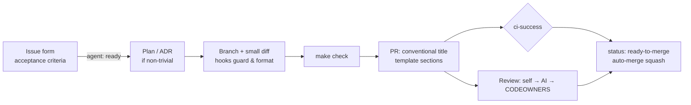

# Best-Practice Full-Stack Template

A starter repo for new full-stack, cloud-native projects. It ships with CI, checks, planning docs and agent tooling
already in place, so humans and coding agents start from the same well-lit path. Delete the sample "items" app,
keep the structure.

Most repositories have no single command that proves a change is safe, no written definition of done, and no
machine-readable rules for agents. This template fixes that:

- **One command per question.** `make check` answers "is this safe to push?". Every CI job is a `make` target, so
  local and CI results mean the same thing.
- **One required check.** Branch protection needs only `ci-success`, which aggregates every job and treats
  path-filtered skips as passing.
- **Written rules for agents.** [`AGENTS.md`](AGENTS.md), task skills in [`.agents/skills`](.agents/skills),
  and hooks that block unsafe commands and format edits automatically.
- **A measurable bar.** The [`repo-audit`](.agents/skills/repo-audit/SKILL.md) skill scores any repository
  against this template and plans the PRs that raise the score. CI runs it on this repo too.

## What's inside

| Layer | Contents |
|---|---|
| Backend | FastAPI, SQLAlchemy 2, Alembic, Postgres · ruff, mypy (strict), pytest (unit + real-Postgres integration) → [`backend/`](backend/README.md) |
| Frontend | Vite, React 19, TypeScript (strict) · ESLint (a11y), Prettier, Vitest, Playwright (mocked + full stack), React Doctor → [`frontend/`](frontend/README.md) |
| Containers | Multi-stage, non-root, read-only-root-FS images; `docker compose` stack with a migration step |
| Deploy | Helm chart (probes, limits, PDB, HPA, NetworkPolicy, migration hook Job, helm test) and a kind e2e → [`docs/deployment.md`](docs/deployment.md) |
| Infra | OpenTofu/Terraform platform module (namespace, quotas, default-deny network policy) → [`infra/terraform`](infra/terraform/README.md) |
| CI | Path-filtered jobs, `ci-success` gate, Playwright, kind, IaC validation, React Doctor → [`docs/ci.md`](docs/ci.md) |
| Security | Trivy (deps, secrets, IaC, images), gitleaks, CodeQL, dependency review, SBOM, cosign signing, SHA-pinned actions → [`docs/security.md`](docs/security.md) |
| PR hygiene | PR template, conventional-title and description checks, automatic type/area/size labels, labels-as-code, issue forms, release notes |
| Agents | `AGENTS.md`, skills, Claude Code / Codex / Cursor hooks, reviewer subagent, AI review workflow, auto-merge → [`docs/agents/`](docs/agents/README.md) |
| Planning | ADRs, design-plan template and an example plan → [`docs/adr`](docs/adr/README.md), [`docs/plans`](docs/plans/README.md) |

## Quick start

Prerequisites: Docker, GNU Make, [uv](https://docs.astral.sh/uv/), Node 24 (`frontend/.nvmrc`), Python 3.11+.
Helm, kind and Trivy are optional; you only need them for the deploy and security targets.

```bash
make setup          # install backend + frontend dependencies
make check          # lint, typecheck, unit tests, React Doctor, repo score: the pre-push gate
make up             # full stack on http://localhost:8080 (Postgres, migrations, API, UI)
make test-integration test-e2e test-e2e-fullstack
make kind-e2e       # deploy the Helm chart to a throwaway kind cluster and smoke-test it
make security       # Trivy, same policy as CI
make help           # everything else
```

## How work flows



- **Humans:** read [`CONTRIBUTING.md`](CONTRIBUTING.md).
- **Agents:** read [`AGENTS.md`](AGENTS.md). The path to agents managing their own PRs (autonomy levels, label
  state machine, guardrails) is in [`docs/agents/self-managed-prs.md`](docs/agents/self-managed-prs.md).
  Worked examples are in [`docs/agents/sample-approaches.md`](docs/agents/sample-approaches.md).

## Audit another repository

```bash
python3 .agents/skills/repo-audit/scripts/audit.py /path/to/other/repo --format markdown
```

The scanner uses only the standard library and reads files without executing anything. It skips checks that don't
apply to the target's stack and prints a prioritized fix list, with links to the template file to adapt for each
fix. To have an agent run the full audit and improvement loop, copy `.agents/skills/repo-audit/` into the target
repo's skills folder.

## Using this as a template

1. Create a repo from this template, then edit `.github/CODEOWNERS`, the image names in
   `deploy/helm/app/values.yaml`, and `--template-url` in the repo-audit skill if you fork it.
2. Configure GitHub. Every workflow runs without these settings; they enable enforcement:
   - Add a branch ruleset on `main` that requires the `ci-success` check, a pull request, and code owner review.
   - Turn on **Allow auto-merge** and **Automatically delete head branches**.
   - Optional secrets:
     - `ANTHROPIC_API_KEY`: enables AI review.
     - `KUBECONFIG`: enables deploys, set per environment under *Settings → Environments*.
   - Run the **Labels sync** workflow once to create the label taxonomy.
3. Replace the sample domain: models, routes, UI, tests. Record the decisions you change as ADRs.
4. Run `make audit`. The repo should keep scoring ≥ 90 as it grows.

Private repositories without GitHub Advanced Security skip code-scanning uploads, CodeQL, dependency review and
attestations. Those jobs check repository visibility, and their results are still published as artifacts and job
summaries. See [`docs/security.md`](docs/security.md).

## License

[Apache-2.0](LICENSE)
