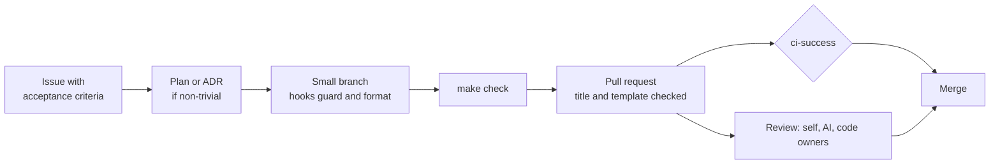

<p align="center">
  
</p>

<p align="center">
  <a href="https://github.com/edwinjosechittilappilly/shipshape-stack/actions/workflows/ci.yml"></a>
  <a href="https://github.com/edwinjosechittilappilly/shipshape-stack/actions/workflows/security.yml"></a>
  <a href="LICENSE"></a>
  <a href=".agents/skills/repo-audit/SKILL.md"></a>
  <a href="https://www.conventionalcommits.org"></a>
  <a href="https://pre-commit.com"></a>
</p>

<p align="center">
  
  
  
  
  
  
  
  
  
  
  
  
  <br>
  
  
  
  
</p>

<p align="center">
  <a href="https://github.com/edwinjosechittilappilly/shipshape-stack/generate"><b>Use this template</b></a> ·
  <a href="#quick-start">Quick start</a> ·
  <a href="#features">Features</a> ·
  <a href="#for-ai-coding-agents">AI agents</a> ·
  <a href="#score-any-repository">Score your repo</a> ·
  <a href="#faq">FAQ</a>
</p>

# ShipShape: the agent-ready full-stack starter template

**ShipShape is an open-source, production-ready starter template for full-stack, cloud-native apps.** Humans and
AI coding agents work to the same standard from the first commit: one command to verify a change, one required check
to merge it, written rules for agents, and a score that shows how close any repo is to that bar.

## TL;DR

- **Stack:** FastAPI + PostgreSQL backend, React 19 + TypeScript frontend, Docker, Helm for Kubernetes, OpenTofu.
- **Quality gate:** `make check` runs the same checks as CI. One required status check, `ci-success`, guards `main`.
- **Tests:** unit, real-Postgres integration, Playwright (mocked API and full stack), plus a deploy to a local kind cluster.
- **Security:** Trivy (dependencies, secrets, IaC, images), gitleaks, CodeQL, SBOM, image signing, actions pinned by SHA.
- **PR hygiene:** conventional-commit titles, required description sections, automatic type/area/size labels.
- **AI agents:** `AGENTS.md`, reusable skills and safety hooks for Claude Code, Codex and Cursor.
- **Repo score:** `repo-audit` grades any repository on 96 checks and plans the PRs that raise the score.

## Contents

- [Why ShipShape](#why-shipshape)
- [Quick start](#quick-start)
- [Features](#features)
- [How a change flows](#how-a-change-flows)
- [For AI coding agents](#for-ai-coding-agents)
- [Score any repository](#score-any-repository)
- [Project structure](#project-structure)
- [Commands](#commands)
- [Use this template](#use-this-template)
- [FAQ](#faq)
- [Contributing and license](#contributing-and-license)

## Why ShipShape

Most repositories have no single command that proves a change is safe, no written definition of done, and no rules
a coding agent can follow. ShipShape makes the safe path the easy path.

| Typical repository | ShipShape |
|---|---|
| CI runs "some tests" and is hard to trust | Every CI job is a `make` target, so a green `make check` means the same as green CI |
| Branch protection lists many fragile job names | One required check, `ci-success`, rolls up every job and treats path-filtered skips as passing |
| PR titles and descriptions vary by author | Titles and description sections are enforced; labels are applied automatically |
| Security is an occasional scan | Trivy, gitleaks and CodeQL on every PR; SBOM and signing on release |
| Agents guess the conventions | `AGENTS.md`, task skills and hooks that block unsafe commands |
| "Is this repo any good?" is an opinion | `repo-audit` gives a score and a prioritised fix list |

## Quick start

**Prerequisites:** Docker, GNU Make, [uv](https://docs.astral.sh/uv/), Node 24 and Python 3.11+. Helm, kind and
Trivy are only needed for the deploy and security targets.

```bash
make setup     # install backend and frontend dependencies
make check     # lint, typecheck, unit tests, React Doctor, repo score
make up        # run the full stack at http://localhost:8080
```

## Features

### Application

| Area | What you get |
|---|---|
| Backend | FastAPI, SQLAlchemy 2, Alembic, PostgreSQL · ruff, strict mypy, pytest with a coverage gate → [`backend/`](backend/README.md) |
| Frontend | Vite, React 19, strict TypeScript · ESLint with accessibility rules, Prettier, Vitest, React Doctor → [`frontend/`](frontend/README.md) |
| Containers | Multi-stage, non-root images that run on a read-only filesystem, base images pinned by digest |

### Testing

| Level | Tool | Command |
|---|---|---|
| Unit | pytest, Vitest | `make test` |
| Integration | pytest against a real PostgreSQL | `make test-integration` |
| End-to-end, mocked API | Playwright | `make test-e2e` |
| End-to-end, full stack | Playwright against Docker Compose | `make test-e2e-fullstack` |
| Deployment | Helm chart on a local kind cluster | `make kind-e2e` |

Testing guide: [`docs/testing.md`](docs/testing.md).

### CI/CD and DevSecOps

| Area | What you get |
|---|---|
| CI | Path-filtered jobs, one `ci-success` gate, workflow linting, pre-commit → [`docs/ci.md`](docs/ci.md) |
| Security | Trivy, gitleaks, CodeQL, dependency review, Dependabot, least-privilege tokens → [`docs/security.md`](docs/security.md) |
| Release | Tag-based multi-arch images on GHCR with SBOM and cosign signing |
| Deploy | Helm with probes, limits, PDB, HPA, NetworkPolicy and a migration job · environment-gated deploy workflow → [`docs/deployment.md`](docs/deployment.md) |
| Infrastructure | OpenTofu/Terraform module for namespace, quotas and default-deny network policy → [`infra/terraform`](infra/terraform/README.md) |

### Collaboration

| Area | What you get |
|---|---|
| Pull requests | Template, title and description checks, automatic labels, optional auto-merge |
| Issues | Bug, feature and agent-ready task forms; labels defined in code |
| Planning | Architecture decision records and a design-plan template → [`docs/adr`](docs/adr/README.md), [`docs/plans`](docs/plans/README.md) |

## How a change flows



## For AI coding agents

ShipShape gives coding agents the same rules as humans and enforces them with tooling.

| Piece | What it does |
|---|---|
| [`AGENTS.md`](AGENTS.md) | One instruction file: repo map, exact commands, definition of done, when to stop and ask a human. `CLAUDE.md` imports it. |
| [Skills](.agents/skills/README.md) | `pull-request`, `writing-issues`, `planning`, `integration-tests`, `playwright-tests`, `code-review`, `ci-triage`, `repo-audit` |
| [Hooks](docs/agents/hooks.md) | For Claude Code, Codex and Cursor: block force-pushes, pushes to `main`, `--no-verify` and reading `.env`; format edited files; refuse to finish while checks fail |
| [Review](docs/agents/review.md) | Agent self-review, then an optional AI reviewer, then code owners |
| [Self-managed PRs](docs/agents/self-managed-prs.md) | Autonomy levels L0 to L4 and a label workflow from `agent: ready` to `status: ready-to-merge` |
| [Sample approaches](docs/agents/sample-approaches.md) | Worked examples: issue to PR, review fixes, dependency updates, CI triage |

> [!CAUTION]
> **Auto-merge is opt-in and not always recommended.** It is only as safe as your required checks and reviews.
> Keep human approval for auth, data migrations, infrastructure, CI workflows, secrets, public APIs,
> `breaking-change` and large PRs. Start with low-risk changes such as docs, tests and dependency patch bumps, then
> widen. Without an `AUTOMERGE_TOKEN` secret, auto-merged commits do not trigger CI on `main`. Add
> `status: needs-human` to stop an auto-merge at any time.

## Score any repository

**Is your repo shipshape?** The `repo-audit` skill scores any repository on 96 checks across 10 categories:
documentation, agent readiness, CI/CD, code quality, testing, security, PR hygiene, containers, developer experience
and frontend health. It skips checks that don't apply to the stack and lists the highest-impact fixes first, each
linked to the template file to adapt.

```bash
python3 .agents/skills/repo-audit/scripts/audit.py /path/to/your/repo --format markdown
```

It needs only the Python standard library and never runs the target's code. To improve another repo, copy
`.agents/skills/repo-audit/` into its skills folder and ask your agent to *"audit this repo and raise its score PR
by PR"*.

## Project structure

```text
.
├── backend/            FastAPI app, Alembic migrations, unit and integration tests
├── frontend/           React app, Vitest tests, Playwright e2e tests, nginx config
├── deploy/             Helm chart and kind cluster config
├── infra/terraform/    OpenTofu/Terraform platform module
├── scripts/            CI helpers, Trivy scan, kind e2e, agent hooks
├── docs/               Architecture, testing, CI, security, deployment, ADRs, plans, agent guides
├── .github/            Workflows, PR and issue templates, labels, CODEOWNERS
├── .agents/skills/     Agent skills, including repo-audit
├── AGENTS.md           Instructions for AI coding agents
└── Makefile            Every command humans, agents and CI use
```

## Commands

| Command | What it does |
|---|---|
| `make setup` | Install backend and frontend dependencies |
| `make check` | The pre-push gate: lint, typecheck, unit tests, React Doctor, repo score |
| `make up` / `make down` | Start or stop the full stack with Docker Compose |
| `make test-integration` | Backend tests against a real PostgreSQL |
| `make test-e2e` / `make test-e2e-fullstack` | Playwright with a mocked API or against the full stack |
| `make kind-e2e` | Deploy the Helm chart to a local kind cluster and smoke-test it |
| `make security` | Trivy scan with the same policy as CI |
| `make audit` | Score this repository |
| `make help` | List every target |

## Use this template

1. Click **[Use this template](https://github.com/edwinjosechittilappilly/shipshape-stack/generate)**.
2. Update `.github/CODEOWNERS`, the image names in `deploy/helm/app/values.yaml` and the security link in
   `.github/ISSUE_TEMPLATE/config.yml`.
3. In GitHub settings, add a branch ruleset on `main` that requires `ci-success` and a pull request. Optionally
   enable auto-merge and add the `ANTHROPIC_API_KEY`, `AUTOMERGE_TOKEN` and `KUBECONFIG` secrets.
4. Run the **Labels sync** workflow once.
5. Replace the sample "items" app with your own domain, and record decisions as ADRs.
6. Keep `make audit` at 90 or above.

> [!NOTE]
> Private repositories without GitHub Advanced Security skip code-scanning upload, CodeQL, dependency review and
> attestations. Results are still published as artifacts and job summaries. Details: [`docs/security.md`](docs/security.md).

## FAQ

### Is ShipShape only for Python and React?

No. The sample app uses FastAPI and React, but the patterns work in any stack: `make` targets, the `ci-success`
gate, pinned actions, hardened containers, skills and hooks. The repo-audit playbook maps each file to Go, Java,
Rust, Ruby and .NET.

### Does it work in private repositories?

Yes. Features that need GitHub Advanced Security run only on public repositories, and their results are still
saved as artifacts.

### Which AI coding agents does it support?

Claude Code, OpenAI Codex and Cursor have hook configs. Any agent that reads `AGENTS.md` or Markdown skills can
follow the same rules.

### Do I need Kubernetes?

No. `make up` runs everything with Docker Compose. Helm, kind and OpenTofu are there for cluster deployments; remove
them if you deploy elsewhere.

### How is this different from cookiecutter or other project generators?

Generators create a project skeleton. ShipShape also ships the way of working around the code: the CI gate,
security policy, PR and issue workflow, review layers, agent guardrails and a repo score.

## Contributing and license

- Humans: read [`CONTRIBUTING.md`](CONTRIBUTING.md). Agents: read [`AGENTS.md`](AGENTS.md).
- Report vulnerabilities privately as described in [`SECURITY.md`](SECURITY.md).
- Licensed under [Apache-2.0](LICENSE).
