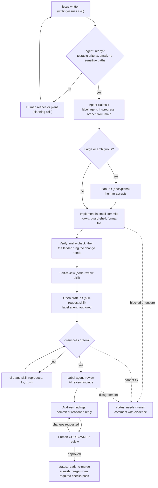

# Working with coding agents

This repository is set up so a human and a coding agent follow the same workflow, with the same checks, and
so an agent's work is reviewable and reversible. Nothing here is magic: it is instructions, small playbooks,
a few guardrail scripts, and CI.

| Piece | Where | Purpose |
| --- | --- | --- |
| Instruction file | [`AGENTS.md`](../../AGENTS.md) | Tool-agnostic entry point: commands, definition of done, rules, escalation |
| Claude notes | [`CLAUDE.md`](../../CLAUDE.md) | `@AGENTS.md` import plus Claude-only notes |
| Skills | [`.agents/skills/`](../../.agents/skills/README.md) | On-demand playbooks, one per recurring task (PRs, issues, planning, tests, review, CI triage, and `repo-audit` to score any repo against these practices) |
| Hooks | [`scripts/agent-hooks/`](../../scripts/agent-hooks) | Guardrails that run around tool calls ([`hooks.md`](hooks.md)) |
| Tool config | `.claude/`, `.codex/`, `.cursor/` | Wires hooks, permissions, commands and subagents into each tool |
| Commands | `.claude/commands/` | `/review`, `/ship-pr`, `/triage-ci`: thin prompts that defer to skills |
| Subagent | `.claude/agents/reviewer.md` | Independent, read-only reviewer using the `code-review` skill |
| AI reviewer | [`.coderabbit.yaml`](../../.coderabbit.yaml), `.github/workflows/agent-review.yml` | Advisory review on PRs ([`review.md`](review.md)) |
| Autonomy policy | [`self-managed-prs.md`](self-managed-prs.md) | Levels L0-L4, label state machine, guardrails |
| Walkthroughs | [`sample-approaches.md`](sample-approaches.md) | Concrete loops and prompts |

## Design principles

1. **One source of truth per concern.** Rules live in `AGENTS.md` and docs; skills hold procedures; tool
   directories hold only wiring. Claude, Codex and Cursor all read the same skills (`.claude/skills` is a symlink
   to `.agents/skills`) and call the same hook scripts.
2. **Keep the always-loaded context small.** `AGENTS.md` is a map and a rulebook (about 150 lines). Long
   procedures live in skills that load when their `description` matches the task.
3. **Same gates as humans.** Agents use the `make` targets CI uses. "Passed locally" means "will pass in CI".
4. **Guardrails fail closed on destructive actions, open on everything else.** Hooks block force-pushes, hook
   bypass and secret reads, but a broken formatter never blocks an edit.
5. **Evidence over assertion.** The PR's Verification table records what was actually run. Reviewers (human and AI)
   check claims against diffs and logs.
6. **A human owns the merge** until the repository explicitly grants more autonomy, one level at a time.

## From issue to merge



The stop-gate hook runs lint and typecheck for changed packages just before the agent finishes, so the
"verify" step happens even if the agent forgets it.

## What each tool reads

| Tool | Instructions | Skills | Hooks | Notes |
| --- | --- | --- | --- | --- |
| Claude Code | `CLAUDE.md` (imports `AGENTS.md`) | `.claude/skills` (symlink) | `.claude/settings.json` | Also commands and the `reviewer` subagent |
| Codex | `AGENTS.md` | `.agents/skills` | `.codex/hooks.json` | Project hooks load only in a trusted project; review them once with `/hooks` |
| Cursor | `AGENTS.md` | reads `.agents/skills` where supported | `.cursor/hooks.json` | Hooks run from the project root |
| Others | `AGENTS.md` | `.agents/skills/*/SKILL.md` as plain markdown | n/a | CI still enforces the gates |

Hook formats and event names were taken from each tool's public documentation; if a tool changes them,
`make hooks-test` still validates the scripts and [`hooks.md`](hooks.md) lists where to adapt the wiring.

## Instruction files: how to keep them good

- Put in `AGENTS.md` only what an agent would otherwise get wrong or waste time discovering: exact commands,
  non-obvious rules, where things live, when to stop. No tutorials, no style rules a linter enforces.
- Prefer a link to a doc over a copy. Duplicated rules drift.
- Every rule should be checkable. "Write clean code" is noise; "no `--no-verify`" is a rule.
- When an agent makes the same mistake twice, add a rule, a test, or a hook (in that order of preference:
  a failing check beats a sentence).
- Review changes to `AGENTS.md`, `.agents/`, `.claude/`, `.codex/`, `.cursor/` and `scripts/agent-hooks/` like
  code: they are owned by CODEOWNERS because they change what automation is allowed to do.

## Auditing a repository

The `repo-audit` skill scores any repository (this one, or an existing project you want to bring up to standard)
against the practices in this template and turns the gaps into a prioritised, PR-by-PR plan. The walkthrough is in
[`sample-approaches.md`](sample-approaches.md#audit-an-external-repo-and-raise-its-score-pr-by-pr).

## Trying it

```bash
make hooks-test                        # prove the guardrails work on this machine
claude                                 # or codex / cursor; ask: "use the planning skill to plan X"
python3 .agents/skills/repo-audit/scripts/audit.py . --format markdown    # score a repo against these practices
```

Next: [`hooks.md`](hooks.md), [`review.md`](review.md), [`self-managed-prs.md`](self-managed-prs.md),
[`sample-approaches.md`](sample-approaches.md).
