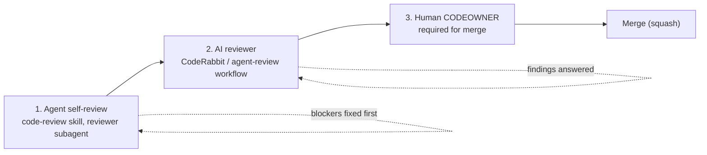

# Layered review

Agent-written code is reviewed in three layers. Each layer is cheaper and faster than the next and catches a different
class of problem; none replaces the last one.



| Layer | Who | Catches | Authority |
| --- | --- | --- | --- |
| 1. Self-review | The authoring agent, ideally via the read-only `reviewer` subagent for an independent context | Missed edge cases, absent tests, stray files, convention violations | None; it only gates opening the PR |
| 2. AI review | [CodeRabbit](../../.coderabbit.yaml) on every PR; `agent-review` workflow when labelled `agent: review` or invoked with `@claude` | Bugs a second pass finds, security smells, convention drift, inconsistency with the linked issue | Advisory: cannot approve, cannot block merge |
| 3. Human review | A CODEOWNER ([`.github/CODEOWNERS`](../../.github/CODEOWNERS)) | Intent, design, risk, whether it should exist at all | Binding: required by branch protection |

## Layer 1: self-review

Before marking a PR ready (and before pushing a substantial fix), run the `code-review` skill against your own diff:

```bash
git diff --stat origin/main...HEAD       # scope: does it match the issue and nothing else?
```

In Claude Code use `/review`, which delegates to the `reviewer` subagent so the review is not biased by the context
that wrote the code. In other tools, start a fresh session (or a fresh agent) with the prompt in
[`sample-approaches.md`](sample-approaches.md#self-review-pass). Rules:

- Blockers and majors are fixed before the PR leaves draft. Minors are fixed or become a follow-up issue. Nits are optional.
- Say in the PR what you checked (`Checked: make check, integration tests`); "looks good" is not evidence.
- If self-review finds you cannot meet the bar (missing test infrastructure, unclear requirement), escalate with
  `status: needs-human` instead of shipping and hoping.

## Layer 2: AI reviewer

Configuration:

- `.coderabbit.yaml` encodes repo conventions as path instructions (migrations, tests, a11y, workflows), so the bot
  reviews against this repo's rules and not generic taste. It runs automatically on non-draft PRs.
- `.github/workflows/agent-review.yml` runs a Claude-based review when a PR is labelled `agent: review` or when a user
  with write access comments `@claude`. Its prompt points at `AGENTS.md` and the `code-review` skill. It does nothing
  (and says so) if the `ANTHROPIC_API_KEY` secret is not configured, so forks and fresh clones stay green.

How findings are handled (author, human or agent):

1. Read all findings first, then group them: real bug, convention, taste, wrong.
2. For each finding, **either** push a commit that fixes it **or** reply with the reason and evidence it does not apply
   (a test, a doc link, the contract). Never ignore silently, never "fix" by suppressing the check.
3. Reference the fix in the reply (`Fixed in abc1234`). Outdated or duplicate findings get a one-line reply.
4. Resolve a conversation only when its fix is pushed or the reviewer agreed it is not an issue. Do not resolve a
   **human's** thread yourself: they resolve their own, or confirm.
5. Push fixes as new commits (no force-push once review has started, so reviewers can see what changed).
6. Re-request review: `gh pr edit <n> --add-label "agent: review"` (re-trigger the AI) and
   `gh pr edit <n> --add-reviewer <codeowner>` for humans. Update the Verification table.
7. Disagreement with the AI reviewer that evidence cannot settle: say why in the thread and leave it for the human reviewer.
   Disagreement between you and a human: follow the human, or label `status: needs-human` and ask.

Reviewer agents posting to GitHub use `gh pr review <n> --comment -F review.md` (or `--request-changes` for
blockers). **They never `--approve`**, and the guard hook blocks it.

## Layer 3: human review

- CODEOWNERS are requested automatically and "Require review from Code Owners" makes their approval mandatory.
  Sensitive paths (`.github/`, `scripts/`, `.agents/`, `.claude/`, `infra/`, `AGENTS.md`) can be given a smaller owner group.
- Reviewers should be able to review from the PR page alone: that is why the description, Verification table and
  screenshots are required. Answer questions in the PR, not in chat.
- Expected turnaround and size norms live in [`CONTRIBUTING.md`](../../CONTRIBUTING.md). Large agent PRs are sent back
  to be split; review quality drops sharply past a few hundred lines.
- On approval the PR gets `status: ready-to-merge`; merging is squash, so the PR title is the commit message.

## What good review output looks like

Use the severity rubric (blocker, major, minor, nit) and the format in the `code-review` skill. Findings cite
`path:line`, say what breaks, and suggest a fix. A review with no findings states what was verified.

## When review stalls

- No human response after the SLA in `CONTRIBUTING.md`: ping once on the PR, then label `status: needs-human`.
- Same finding returns after two fixes: stop; the requirement or design is unclear. Ask a question on the PR.
- AI reviewer produces noise: tighten `.coderabbit.yaml` path instructions in a PR rather than ignoring the bot.
