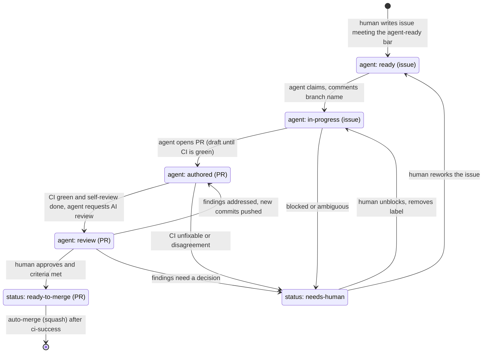

# Self-managed pull requests

The goal: an agent takes a well-specified issue to a merged PR with a human involved only where judgement is needed.
This document defines how much autonomy is granted, how work moves through labels, and the guardrails that keep it safe.
Autonomy is **granted per repository, per level, in a PR to this file**; the default is L1.

## Autonomy levels

| Level | Name | Agent may | Human does | Required to enable |
| --- | --- | --- | --- | --- |
| **L0** | Suggest | Read, analyse, propose changes in chat or as comments | Applies everything | Nothing |
| **L1** | Draft | Create branches, commit, push feature branches, open **draft** PRs, reply to review, fix CI | Marks ready, reviews, approves, merges | Hooks installed; agents have push access to branches only |
| **L2** | Drive | L1 + mark ready, request review, apply labels, run the review-fix and CI-triage loops unattended | Reviews, approves, merges | `agent: review` workflow configured; branch protection requires `ci-success` and CODEOWNERS review |
| **L3** | Queue | L2 + set `status: ready-to-merge` on PRs that meet the merge criteria below (auto-merge then waits for checks and the human approval) | Approves (the approval is the real merge decision) | Auto-merge enabled; label automation (`automerge.yml`); audit trail reviewed monthly |
| **L4** | Auto-merge | L3 + merge low-risk PRs with **no** human approval (docs typo fixes, dependency patch bumps passing all checks) | Reviews a sample, owns the policy | Ruleset exemption limited to a defined path allowlist and size limit; separate bot identity; kill switch tested |

Rules that hold at every level:

- An agent **never approves** a PR, never merges its own PR above the level that allows it, never bypasses branch
  protection (`--admin`), and never edits the guardrails (`.github/`, hooks, branch protection, `AGENTS.md`) without a human owner requesting it.
- Moving up a level requires a PR to this file, a week at the previous level without a guardrail incident, and an owner's approval.
- A single serious incident (secret leaked, unreviewed merge, destructive command) drops the repo back to L1 until a post-mortem lands.

## Label state machine

Labels (defined in `.github/labels.yml`) are the shared state between humans, agents and automation. One label per
state; transitions are made by the actor named on the arrow.

| Label | On | Set by | Meaning |
| --- | --- | --- | --- |
| `agent: ready` | issue | human (or agent proposing, human confirming) | Specified well enough for an agent (see `writing-issues`) |
| `agent: in-progress` | issue | agent | Claimed; avoid duplicate work. Remove `agent: ready` |
| `agent: authored` | PR | agent | Opened by an agent. Never removed; used for audit and metrics |
| `agent: review` | PR | agent or human | Run the AI review now. Remove after the review lands so it can be re-requested |
| `status: ready-to-merge` | PR | human (L1-L2) or agent meeting criteria (L3+) | Triggers auto-merge once required checks and reviews pass |
| `status: needs-human` | issue or PR | anyone, especially the agent | Agent has stopped and is waiting. Blocks auto-merge. Only a human removes it |
| `status: blocked` | issue or PR | anyone | Waiting on something external; comment says what |

`status: needs-human` always wins: automation does nothing to an item that carries it.

### Merge criteria (for `status: ready-to-merge`)

All must be true: `ci-success` green on the latest commit; no unresolved review thread; at least one CODEOWNER approval (L1-L3);
Verification table filled and truthful; diff within the size limit; no paths on the sensitive list changed (unless a human
owner is a reviewer); no `status: needs-human` or `status: blocked`; PR not in draft; migrations (if any) reversible.

## Guardrails

| Guardrail | Where it is enforced | Notes |
| --- | --- | --- |
| Required status check `ci-success` | Branch ruleset on `main` | Single aggregate job; skipped jobs count as pass only if they were legitimately skipped |
| CODEOWNERS review required | Branch ruleset "Require review from Code Owners" | The agent's identity is never a CODEOWNER; it cannot approve |
| Sensitive paths | `.github/CODEOWNERS` | `.github/`, `scripts/`, `.agents/`, `.claude/`, `AGENTS.md`, `infra/`, `SECURITY.md` owned by a small group |
| Size limit | Size labels (`size/L` and above need a human to confirm) and agent rules (< ~400 lines) | Split via the plan's PR slices |
| No force-push, no push to `main`, no `--no-verify`, no hook bypass | `guard-shell.sh`; ruleset blocks direct pushes and force-pushes to `main` | Hooks help the agent; the ruleset is the actual boundary |
| No secrets | `.env*` read blocked; gitleaks in pre-commit and CI; Trivy | Agents get no production credentials, ever |
| Least-privilege tokens | Workflow `permissions:` minimal; agent token scoped to contents and pull requests on this repo | No `workflow` scope, no admin |
| Escape hatch | Label `status: needs-human` + comment with evidence | Defined stop conditions are in `AGENTS.md` |
| Audit trail | `agent: authored` label, PR descriptions, commit trailers, Actions logs | See below |
| Kill switch | Remove the agent's token / disable the automation workflows; set `AGENT_HOOKS_BYPASS` nowhere | Test it before enabling L3 |

### Audit trail

- Every agent PR carries `agent: authored` and a commit trailer such as `Co-authored-by:` or `Assisted-by:` naming the tool.
- The PR description records exactly what was verified; the issue records who claimed it and when.
- Weekly query for review: `gh pr list --label "agent: authored" --state merged --search "merged:>=YYYY-MM-DD"`.
  Sample a few for quality; track revert rate, CI re-runs, and `needs-human` frequency as the health metrics.

## Sample approaches

1. **Issue-to-PR loop (L1-L2).** Trigger: `agent: ready` issue. The agent claims it, branches, implements with tests,
   climbs the verification ladder, self-reviews, opens a draft PR, fixes CI, then marks it ready. Stops on any escalation rule.
2. **Review-fix loop (L2).** Trigger: review comments or AI findings on an `agent: authored` PR. The agent groups findings, fixes or
   answers each, pushes, re-requests review; bounded to three iterations before `status: needs-human`.
3. **CI-triage agent (L2).** Trigger: failed `ci-success` on an agent PR (or on `main`). Reproduces locally, classifies (real,
   flaky, infra), fixes real failures in a small commit, never retries blindly, opens a revert PR for a red `main` it cannot fix quickly.
4. **Dependency-update agent (L3-L4).** Trigger: Dependabot/Renovate PR. Reads the changelog for breaking changes, runs the
   ladder, fixes call sites, and either labels `status: ready-to-merge` (patch/minor, all green) or `status: needs-human` (major, unclear).
   The only candidate for L4 and only for patch bumps within an allowlist.
5. **Docs/chore janitor (L3).** Fixes typos, stale links, outdated commands (found via `repo-audit` or link checkers) in tiny PRs.

Prompts and step lists for each are in [`sample-approaches.md`](sample-approaches.md).

## Rollout plan

| Phase | Goal | Exit criteria |
| --- | --- | --- |
| 0. Foundations | Branch ruleset with `ci-success` + CODEOWNERS review; labels created; hooks installed (`make hooks-test` green); `AGENTS.md` reviewed | A human PR passes through every gate |
| 1. L1 on low-risk work | Agents open draft PRs for `good first issue`/`agent: ready` docs and test tasks | 10 agent PRs merged; median human edits per PR trending down; zero guardrail incidents |
| 2. L2 with AI review | Enable `agent: review` workflow and CodeRabbit; agents run review-fix and CI-triage loops | Revert rate under 5%; `needs-human` used (not avoided) on ambiguous work |
| 3. L3 queue | Enable `status: ready-to-merge` by agents for PRs meeting criteria; auto-merge after approval | Humans spend review time on design, not nits; audit sample shows truthful Verification tables |
| 4. L4 allowlist | Auto-merge only the allowlisted low-risk classes (for example patch dependency bumps) | Monthly audit clean; kill switch drilled; owners agree to continue |

Back off one level at any time by editing this file and the ruleset; nothing else depends on the level.

## Repository settings checklist (owner, one time)

- [ ] Branch ruleset on `main`: require PR, require `ci-success`, require CODEOWNERS review, block force-push and deletion, require linear history
- [ ] Allow squash merge only; enable auto-merge; delete branch on merge
- [ ] Labels synced from `.github/labels.yml`
- [ ] Secrets: `ANTHROPIC_API_KEY` (optional, for `agent-review`); no production secrets available to agent workflows
- [ ] CODEOWNERS handles replaced with real users or teams
- [ ] Private repo note: code scanning, CodeQL and dependency-review need GitHub Advanced Security; the workflows gate them on
  repository visibility and always publish results as artifacts (see [`../ci.md`](../ci.md))
