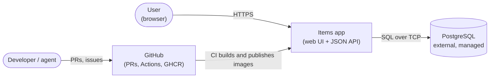
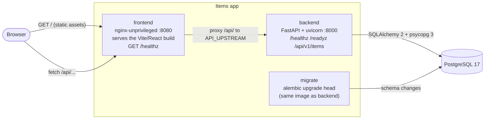
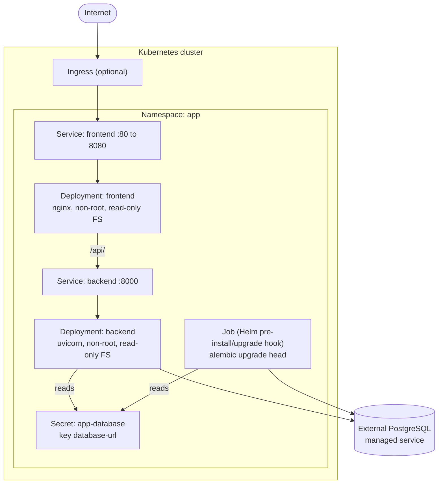
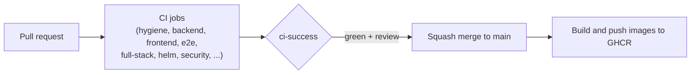

# Architecture

The template ships a deliberately small system, a to-do style **items** app, so that every layer of a real cloud-native
project (UI, API, database, migrations, containers, Helm, CI) has a working, tested example. Replace the domain; keep the shape.

Diagrams use [Mermaid](https://mermaid.js.org/) in the C4 style (context, then containers, then deployment) and render on GitHub.

## System context

Who uses the system and what it depends on.



## Containers

The runtime parts of the app and how they talk. The browser only ever talks to the frontend origin; nginx forwards `/api/` to
the backend, so there is no CORS in production and the frontend uses relative URLs everywhere.



| Container | Image | Responsibility | Notable rules |
| --- | --- | --- | --- |
| `frontend` | nginx-unprivileged image | Serve static build, proxy `/api/`, expose `/healthz` | Non-root, read-only root filesystem, `API_UPSTREAM` via envsubst |
| `backend` | multi-stage uv image | Validate input, apply business rules, persist items | Non-root uid 10001, read-only root filesystem, config from env, no migrations at start |
| `migrate` | same image as `backend` | Run Alembic migrations once per release | A separate step: compose service locally, Helm hook Job in Kubernetes |
| `postgres` | `postgres:17` locally; managed service in production | Persist data | Credentials only from env/Secret |

### Backend structure

```text
backend/src/app/
  main.py          create_app() factory: settings, logging, CORS, router wiring
  config.py        the only place environment variables are read (pydantic settings)
  log_config.py    structured JSON logging to stdout
  db.py            engine and session dependency
  models.py        SQLAlchemy 2 typed models
  schemas.py       Pydantic request/response models (the API contract)
  api/             thin HTTP layer: health.py, items.py, deps.py (dependency wiring)
  service.py       business rules, independent of HTTP and SQL
  repository.py    the only code that issues SQL
backend/migrations/  Alembic environment and versions (run as a separate step)
```

Dependencies point one way: `api` calls `service`, `service` calls `repository`, and nothing imports upward. Handlers parse
input and map exceptions to status codes; rules live in the service. That seam is also what makes the unit tests fast: they swap
the repository for an in-memory fake, while integration tests use the real SQL repository against Postgres.

### Frontend structure

```text
frontend/src/
  api/           typed fetch wrappers for /api/v1 (the only place that knows URLs)
  components/    presentational components with accessible names the e2e tests rely on
  App.tsx        composition and data loading
frontend/e2e/    Playwright: `mocked` (Vite + page.route) and `fullstack` (real stack) projects
```

## Deployment view

How the same containers run on Kubernetes through the Helm chart in `deploy/helm/app`.



Operational notes:

- **The database is external.** The chart never deploys Postgres; `DATABASE_URL` is read from a Secret you create
  (`database.existingSecret`, default `app-database`, key `database-url`) or from an external secret operator. `deploy/kind/`
  contains a dev-only Postgres manifest for local clusters.
- **Hardening:** non-root, read-only root filesystems (writable paths are `emptyDir` mounts), dropped capabilities, and
  optional NetworkPolicy, PodDisruptionBudget, and autoscaling templates.
- **Probes:** liveness → `/healthz` (no dependencies, so a DB outage does not restart pods), readiness → `/readyz` (checks the
  database, so unhealthy pods leave the Service).
- **Migrations** run in a hook Job before the new pods roll out, which is why every migration must be backwards compatible with
  the previous release ([conventions](conventions.md#database-migrations)).
- Details, values, and rollout procedures: [`deployment.md`](deployment.md).

## Delivery pipeline



CI calls only `make` targets, so every check is reproducible locally; see [`ci.md`](ci.md).

## Key decisions

| Decision | Record |
| --- | --- |
| We record significant decisions as ADRs | [ADR-0001](adr/0001-record-architecture-decisions.md) |
| Monorepo, one Makefile per package, a single `ci-success` gate | [ADR-0002](adr/0002-monorepo-per-package-makefiles-single-ci-gate.md) |
| Non-root, read-only containers; Helm deploy with an external database | [ADR-0003](adr/0003-hardened-containers-helm-external-database.md) |

Larger changes start as a [plan](plans/README.md); once decided they are summarised in an ADR.
