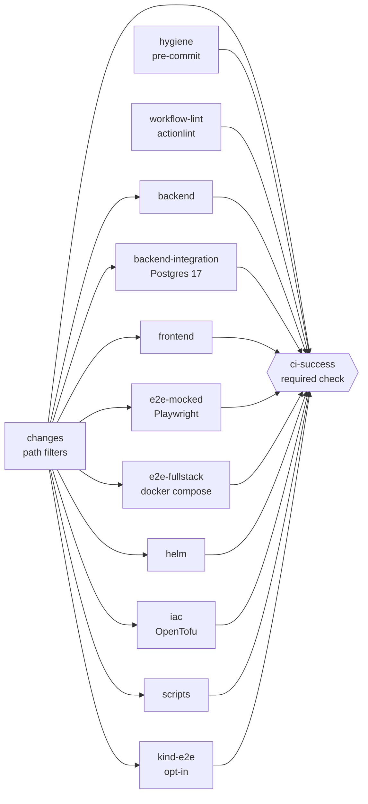

# Continuous integration

CI is a set of GitHub Actions workflows in [`.github/workflows/`](../.github/workflows). Design rules:

1. **Jobs call `make` targets.** Whatever a job does, you can do on your laptop with the same command, so "it passed locally" and "it passed in CI" mean the same thing.
2. **One required check: `ci-success`.** It aggregates every job in `ci.yml`, so skipped jobs never block a PR and new jobs are covered by adding one line.
3. **Least privilege.** Workflows start from `permissions: {}`; each job grants only what it needs. Every job has a `timeout-minutes`. Checkouts use `persist-credentials: false`.
4. **Everything is pinned.** Actions by commit SHA, tool binaries by checksum. See [security.md](security.md#supply-chain-rules).

## Job graph (`ci.yml`)

`hygiene` and `workflow-lint` always run; they are cheap and guard files every change touches. Everything else is gated by path filters.

## What each job checks

| Job | Checks | Run locally |
| --- | --- | --- |
| `changes` | Computes which areas a PR touches ([`changes-filter.yml`](../.github/changes-filter.yml)). Pushes to `main`, merge-queue runs, schedules and manual runs run everything. | n/a |
| `hygiene` | `pre-commit run --all-files`: whitespace, YAML/JSON/TOML syntax, secrets, ruff, shellcheck, actionlint, markdownlint, yamllint. | `uvx pre-commit run --all-files` |
| `workflow-lint` | actionlint on all workflows, including shellcheck of every `run:` block. | `docker run --rm -v "$PWD:/repo" -w /repo rhysd/actionlint:latest -color` |
| `backend` | ruff lint and format check, mypy (strict), unit tests. | `make -C backend lint typecheck test` |
| `backend-integration` | Integration tests against a `postgres:17` service container (`DATABASE_URL`), including migrations round trip. | `make test-integration` (starts Postgres through compose) |
| `frontend` | ESLint, Prettier check, `tsc`, Vitest, production build, React Doctor. | `make -C frontend lint typecheck test build doctor` |
| `e2e-mocked` | Playwright `mocked` project: Vite dev server with the API stubbed. Uploads report and traces on failure. | `make -C frontend playwright-install test-e2e` |
| `e2e-fullstack` | `make up` (Postgres, migrations, backend, frontend in compose), then the Playwright `fullstack` project. Uploads compose logs, report and traces on failure; always runs `make down`. | `make test-e2e-fullstack` |
| `helm` | `helm lint --strict`, `helm template`, kubeconform schema validation (default values and every `deploy/kind/values*.yaml`). | `make helm-lint` |
| `iac` | `tofu fmt -check` and `tofu init -backend=false && tofu validate` for every directory under `infra/terraform`. | `tofu fmt -check -recursive infra/terraform` |
| `scripts` | Unit tests of `scripts/ci`, agent hook self-tests, shellcheck, unit tests of the repo-audit skill, and the **repo audit** (score must stay at or above 90; the report is added to the job summary). | `make hooks-test`, `python3 -m unittest discover -s scripts/ci/tests -t .`, `python3 .agents/skills/repo-audit/scripts/audit.py . --min-score 90` |
| `kind-e2e` | Builds both images, creates a kind cluster, installs the chart (migration hook Job), smoke-tests through the frontend proxy, runs `helm test`. | `make kind-e2e` |
| `ci-success` | Fails if any job above failed or was cancelled. Skipped is fine. | n/a |

### `kind-e2e` is opt-in on pull requests

It is slow, so it runs on pushes to `main`, on the weekly schedule, on manual runs with the `kind_e2e` input, and on PRs that **already carry the `run: kind-e2e` label when the run starts**. Add the label when opening the PR (`gh pr create --label "run: kind-e2e"`) or before pushing the next commit. Labelling an open PR does not start a new run on purpose: the labeler bot labels every new PR, and a `labeled` trigger would restart the whole pipeline for each label. Use *Actions → CI → Run workflow* with `kind_e2e` for an immediate run.

## Path filters

[`.github/changes-filter.yml`](../.github/changes-filter.yml) maps areas to globs (`backend`, `frontend`, `fullstack`, `helm`, `iac`, `scripts`, `kind`). Files that affect every job (the root `Makefile`, `ci.yml` and the filter itself) are in a shared anchor. When you add a directory that a job depends on, add it to that job's filter; a wasted run is cheaper than a regression that skipped its own check.

## Other workflows

| Workflow | Trigger | Purpose |
| --- | --- | --- |
| `pr-checks.yml` | PR opened/edited/labeled/... | Validates title (Conventional Commits) and description sections with `scripts/ci/check_pr.py`. Read-only. Errors appear as annotations and in the job summary. |
| `pr-labeler.yml` | `pull_request_target` | Adds `area:` labels from changed paths, `type:`/`breaking-change` labels from the title, and exactly one `size/` label. |
| `react-doctor.yml` | PR touching `frontend/**`, push to `main` | Advisory React Doctor scan: sticky PR comment, inline comments and a commit status. Never fails the check; set `blocking: error` in the workflow to turn it into a gate. `make -C frontend doctor` runs the same ruleset in the `frontend` job. |
| `security.yml` | PR, push to `main`, weekly | Trivy, gitleaks, dependency review. See [security.md](security.md). |
| `codeql.yml` | PR, push to `main`, weekly | CodeQL for Python, JS/TS and workflows (public repos only). |
| `release.yml` | tag `vX.Y.Z` | Multi-arch images to GHCR, SBOM, signatures, provenance, GitHub Release. |
| `deploy.yml` | Release success, manual | `helm upgrade --install --atomic` by image digest, then smoke test. No-ops without a `KUBECONFIG` secret. |
| `automerge.yml` | label `status: ready-to-merge` | Enables squash auto-merge; GitHub merges after required checks and reviews pass. Uses the `AUTOMERGE_TOKEN` secret when set, because merges made with `GITHUB_TOKEN` do not trigger `push` workflows (no post-merge CI on `main`). |
| `agent-review.yml` | label `agent: review`, `@claude` comment | Optional AI review. No-ops without the `ANTHROPIC_API_KEY` secret. |
| `labels-sync.yml` | push touching `labels.yml`, manual | Applies [`.github/labels.yml`](../.github/labels.yml) to the repository. |
| `stale.yml` | daily | Marks inactive issues and PRs stale after 60 days, closes after 21 more. |

### Label automation

- `type:` labels come from the PR **title**, so change the title rather than the label. `feat` becomes `type: feature`, `fix` becomes `type: bug`, `chore`, `build`, `style` and `revert` become `type: chore`; the other types map to the label of the same name. `!` in the title (or a `BREAKING CHANGE:` footer in the body) adds `breaking-change`.
- `size/` is computed from changed lines: XS under 10, S under 50, M under 200, L under 500, XL from 500. Lockfiles (`uv.lock`, `package-lock.json`, ...) and generated files (`dist/`, `generated/`, `*.min.js`, snapshots, protobuf stubs) are excluded. Only one size label exists at a time.
- `area:` labels come from [`labeler.yml`](../.github/labeler.yml).
- `status:` and `agent:` labels are set by people and agents; automation only reads them.

The logic is in [`scripts/ci/pr_labels.py`](../scripts/ci/pr_labels.py) (pure functions, unit-tested). `pr-labeler.yml` runs on `pull_request_target` and therefore only ever executes this script from the base branch; see [security.md](security.md#pull_request_target-rules).

## Required repository settings

Workflows alone cannot enforce policy. Configure once (Settings):

1. **Rulesets → protect `main`:** require a pull request, require status checks `ci-success` (and optionally `PR checks / validate`), require branches to be up to date, require review from Code Owners, block force pushes and deletions.
2. **General → Pull Requests:** enable *Allow auto-merge* and *Allow squash merging*, enable *Automatically delete head branches*.
3. **Actions → General:** workflow permissions *Read repository contents* by default; allow only actions from this repository and verified creators if you want a stricter allowlist; require approval for fork PRs.
4. **Environments:** `staging`, `production` with the `KUBECONFIG` secret; add required reviewers on `production`.
5. **Secrets (optional):** `ANTHROPIC_API_KEY` for `agent-review.yml`; `AUTOMERGE_TOKEN` (fine-grained PAT or GitHub App token with Contents + Pull requests write) so auto-merged commits trigger CI, security and release workflows on `main`.
6. **Merge queue (optional):** `ci.yml` already listens to `merge_group`.

## Caching

| What | How | Key |
| --- | --- | --- |
| Python deps and uv cache | `astral-sh/setup-uv` `enable-cache` | `backend/uv.lock` |
| npm cache | `actions/setup-node` `cache: npm` | `frontend/package-lock.json` |
| Playwright browsers | `actions/cache` on `~/.cache/ms-playwright` | OS + `package-lock.json` |
| pre-commit environments | `actions/cache` on `~/.cache/pre-commit` | `.pre-commit-config.yaml` |
| Docker layers (security scan, release) | BuildKit `type=gha` cache | scope per image |
| Trivy vulnerability DB | `actions/cache` on `~/.cache/trivy` | per run, prefix restore |

Caches only store inputs that are fully determined by a lockfile or config, never build outputs, so a stale cache cannot make a bad build look green.

## Flaky tests

A flaky test is a bug in the test (or the code) and is treated like one.

1. **Never** add blind retries to hide it, and never re-run until green without recording what happened.
2. When a CI failure disappears on re-run, open an issue with the label `type: bug` and `area: tests`, paste the failing job URL and the first error, and link it in the PR.
3. Quarantine only with a tracking issue: mark the test skipped with the issue number in the reason (`@pytest.mark.skip(reason="#123 flaky: ...")`, `test.fixme`), and fix it within two weeks.
4. Playwright retries are limited to what `playwright.config.ts` sets for CI; traces are uploaded on failure so the cause can be read, not guessed.
5. Triage with the `ci-triage` agent skill (`.agents/skills/ci-triage/SKILL.md`).

## Pinned tools and how to bump them

| Pin | Where | Bumped by |
| --- | --- | --- |
| GitHub Actions (SHA + `# vX.Y.Z`) | every `uses:` | Dependabot (weekly, grouped) |
| uv, pre-commit, OpenTofu, Helm, kind | `env:` at the top of `ci.yml` (Helm also in `deploy.yml`) | by hand, one PR |
| trivy, gitleaks, actionlint, kubeconform | `scripts/ci/install-tool.sh` (version + SHA-256) | by hand, one PR |
| pre-commit hook revisions | `.pre-commit-config.yaml` | `uvx pre-commit autoupdate --freeze` |
| Base images | `Dockerfile`s | Dependabot (`docker` ecosystem) |

To bump a binary tool: change `version` and `sha256` in `install-tool.sh` (the checksum is in the project's release `checksums.txt`), read the upstream release notes, and test with `docker run --rm --platform linux/amd64 -v "$PWD:/repo" -w /repo ubuntu:24.04 ...` or simply let the PR's CI run, since a wrong checksum fails loudly.

## Adding a job

1. Make the check runnable with a `make` target (or one documented command) and verify it locally.
2. If it is path-dependent, add a filter in `.github/changes-filter.yml` and an output in the `changes` job.
3. Add the job to `ci.yml` with: `needs: changes` and an `if:` on its output, `runs-on`, **`timeout-minutes`**, **least-privilege `permissions`**, `actions/checkout` with `persist-credentials: false`, and SHA-pinned actions.
4. Upload artifacts on failure when the failure is hard to reproduce.
5. **Add the job to `ci-success.needs`.** A job missing there is not required, whatever the ruleset says.
6. Run `actionlint` locally and update the table in this document.

## Debugging a red pipeline

Open the failed job's summary first (the `ci-success` summary lists every job result). Reproduce with the command in the table above. For browser failures download the `playwright-*` artifact and open the trace with `npx playwright show-trace`. For full-stack failures read `compose.log` in the artifact. Workflow syntax errors show up in `workflow-lint` before anything else runs.
